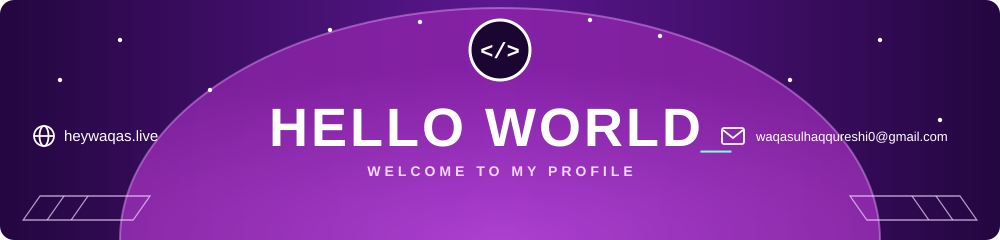
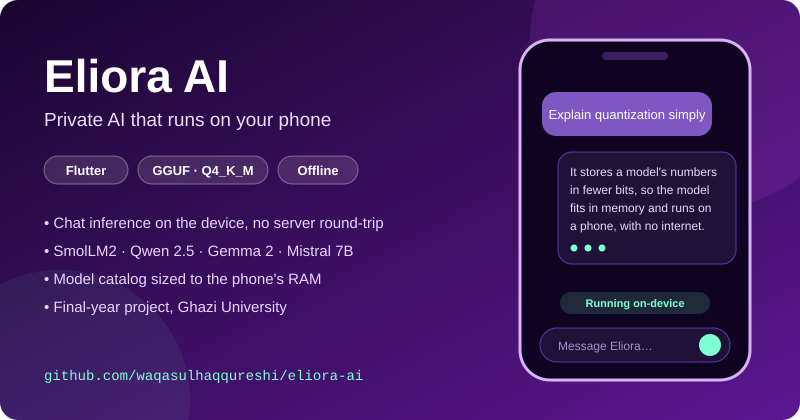
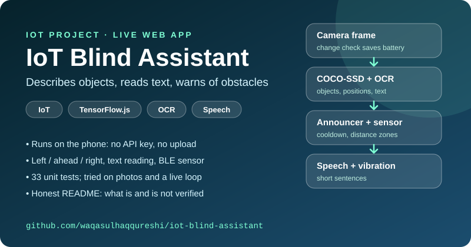
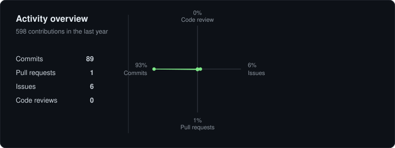

  

# 🧑‍💻 I'M WAQAS!

*Software developer · Flutter, React & Next.js · private, on-device AI*

I build products that keep working when the network, the budget or the user's eyesight is the constraint: apps that run models locally so nothing you type leaves the phone, and interfaces people can actually use.

- 💼 Software Developer (remote) at **SDL Pro**, a platform for the UK scaffolding and construction industry (since Aug 2026)
- 🎓 **BS Information Technology**, Ghazi University (2022–2026): CGPA **3.56 / 4.00**, final-semester GPA **3.95**
- 🔒 Final-year project **[Eliora AI](https://github.com/waqasulhaqqureshi/eliora-ai)**: a Flutter assistant that runs quantized SmolLM / Qwen-class models on the device, so chats stay offline
- 🦯 **[IoT Blind Assistant](https://github.com/waqasulhaqqureshi/iot-blind-assistant)**: an IoT course prototype (camera, OpenCV, Cloud Vision, text-to-speech, mobile app) that describes objects and text to visually impaired users; architecture and tested code are in the repo
- 🧭 Looking for: a fully funded **MS / research** place in on-device AI, edge computing or accessibility, and software internships
- 🌐 Portfolio: **[heywaqas.live](https://heywaqas.live)** · 📫 [waqasulhaqqureshi0@gmail.com](mailto:waqasulhaqqureshi0@gmail.com)

 

<h2 align="center">My favorite projects 💻</h2>

<table>
  <tr>
    <td width="50%">
      
    </td>
    <td width="50%">
      
    </td>
  </tr>
</table>

## What problem do I fix?

| Problem | What I build |
| --- | --- |
| AI that needs a server, a subscription or your data | Quantized models running on the phone: private, offline, no usage cap |
| Products that exclude people | Assistive vision: the world narrated aloud for blind and low-vision users |
| Teams that need a UI shipped from design to store | Flutter and React/Next.js, from Figma wireframes to release |

## Tech

## Contribution activity

## Contribution snake

<picture>
  <source
    media="(prefers-color-scheme: dark)"
    srcset="https://raw.githubusercontent.com/waqasulhaqqureshi/waqasulhaqqureshi/output/github-contribution-grid-snake-dark.svg"
  />
  
</picture>
